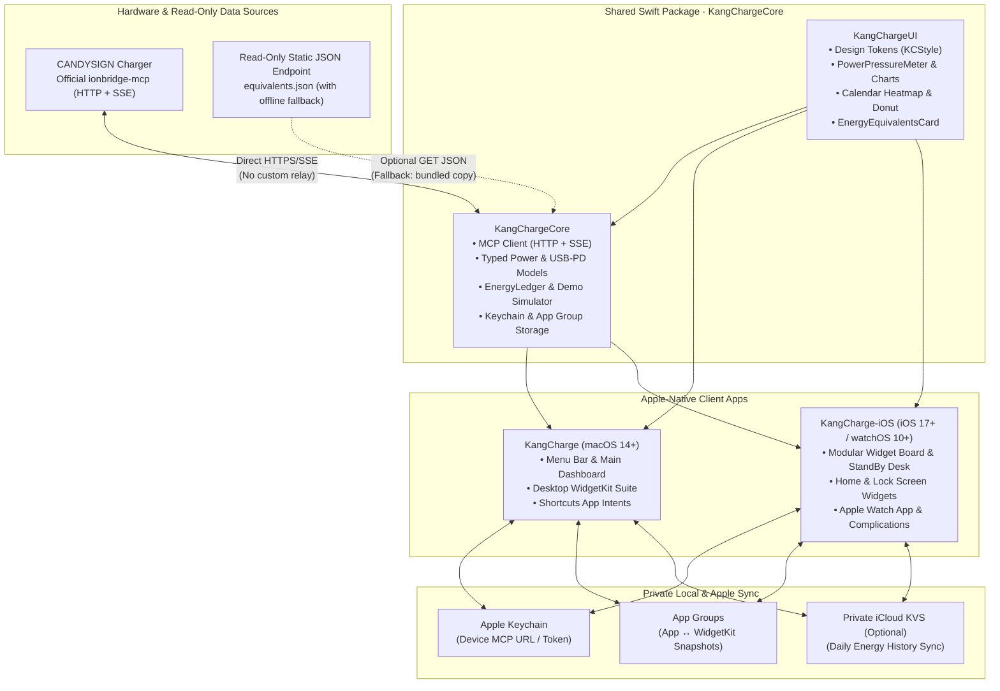

# SugarWatt Architecture & How It Works

SugarWatt (open-source repos: [KangChargeCore](https://github.com/LeiZiKang/KangChargeCore), [KangCharge (macOS)](https://github.com/LeiZiKang/KangCharge), [KangCharge-iOS (iOS & watchOS)](https://github.com/LeiZiKang/KangCharge-iOS)) is an Apple-native, zero-relay companion suite for CANDYSIGN CoCan smart desk chargers.

---

## 1. Architecture Diagram



---

## 2. How It Works (运行原理)

### 2.1 Direct Charger Communication (Zero Custom Backend)
1. **Credential Storage**: When you paste your charger's MCP endpoint (or full prompt text copied from the CANDYSIGN app), `AppConfig.extractMCPInput` extracts the `/sse` URL and stores it strictly locally in the **Apple Keychain**. There is no user account system and no third-party relay server.
2. **HTTP + SSE MCP Client**: `KangChargeCore` opens an official `ionbridge-mcp` session directly from your Mac, iPhone, or Apple Watch to read live per-port telemetry (watts, voltage, current, fast-charge protocol, cable E-Marker, chip temperature, and USB-PD battery state) and execute safe port controls.
3. **Hardware-Free Demo Mode**: When no charger is connected, a local simulator inside `KangChargeCore` generates realistic multi-port telemetry so every screen, chart, and widget works immediately offline.

### 2.2 Daily Energy Ledger & Cross-Device Sync
1. **Hardware Counter Integration**: `EnergyLedger` tracks cumulative charging energy from the charger's `session_charge_mwh` counter, bucketing totals by day, port, hour-of-day, and weekday.
2. **WidgetKit & Watch Sharing**: Live snapshots and daily energy summaries are persisted into an **App Group** container so Home Screen, Lock Screen, Desktop, and Apple Watch complications stay up to date without duplicating network sessions.
3. **Optional iCloud KVS**: Daily energy history can optionally sync between your own Mac and iPhone through Apple's private `NSUbiquitousKeyValueStore` (never touching any external database).

### 2.3 Lightweight Static JSON for Energy Equivalents
To make `kWh` numbers intuitive (e.g., *"equivalent to 12 iPhone charges"*), SugarWatt uses a tiny, read-only static JSON catalog ([`LeiZiKang/sugarwatt-equivalents`](https://github.com/LeiZiKang/sugarwatt-equivalents)):

- On launch (throttled & cached), `EnergyEquivalentsCatalog` performs a simple read-only `GET` for `equivalents.json`.
- If offline or unreachable, it transparently falls back to the identical JSON bundled inside the app — zero hard dependency on any server.

#### Current `equivalents.json` Entries

| ID | SF Symbol | `kwhPerUnit` | English | 简体中文 |
| --- | --- | ---: | --- | --- |
| `iphone_charge` | `iphone` | `0.017` | iPhone 16 Pro charges | 台 iPhone 充满电 |
| `espresso` | `cup.and.saucer.fill` | `0.025` | Cups of espresso brewed | 杯意式浓缩咖啡 |
| `macbook_charge` | `laptopcomputer` | `0.070` | MacBook Pro full charges | 次 MacBook Pro 满充 |
| `kettle_boil` | `flame.fill` | `0.110` | 1L kettles boiled | 壶 1L 烧开的热水 |
| `ev_km` | `car.fill` | `0.145` | EV highway range | 电动车续航里程 |
| `laundry` | `washer.fill` | `0.850` | Loads of laundry | 桶滚筒洗衣机清洗 |

```json
[
  {
    "id": "iphone_charge",
    "symbol": "iphone",
    "kwhPerUnit": 0.017,
    "titleEn": "iPhone 16 Pro charges",
    "titleZh": "台 iPhone 充满电",
    "unitEn": "charges",
    "unitZh": "次",
    "minKwh": 0.005,
    "maxKwh": 25
  },
  {
    "id": "espresso",
    "symbol": "cup.and.saucer.fill",
    "kwhPerUnit": 0.025,
    "titleEn": "Cups of espresso brewed",
    "titleZh": "杯意式浓缩咖啡",
    "unitEn": "cups",
    "unitZh": "杯",
    "minKwh": 0.01,
    "maxKwh": 40
  }
]
```

Want to add a fun new energy equivalent? Open a Pull Request on [sugarwatt-equivalents](https://github.com/LeiZiKang/sugarwatt-equivalents)!
