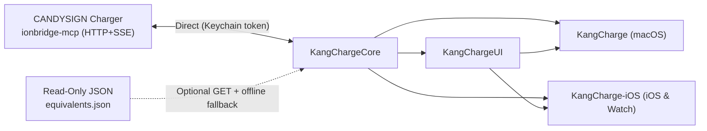

# KangChargeCore

Shared Swift Package powering **SugarWatt** ([macOS](https://github.com/LeiZiKang/KangCharge) and [iOS & watchOS](https://github.com/LeiZiKang/KangCharge-iOS)).

## Modules

- **`KangChargeCore`**: HTTP+SSE MCP client for CANDYSIGN `ionbridge-mcp`, smart MCP URL/prompt extractor (`AppConfig.extractMCPInput`), typed models (including USB-PD battery fraction), Keychain & App Group storage, `EnergyEquivalentsCatalog`, and `EnergyLedger` (daily/port/hourly/weekday energy accumulator with optional iCloud KVS cross-device sync).
- **`KangChargeUI`**: Shared ceramic & graphite Apple-native SwiftUI design tokens (`KCStyle`), smart device SF Symbols (`KCDeviceSymbol`), reusable `CalendarHeatmapView` / `EnergyHeatmapView`, `PortEnergyDonutChart`, `EnergyTimePatternChart` (By Hour / By Weekday), `EnergyEquivalentsCard`, and living 8-segment `PowerPressureMeter`.

## Architecture & How It Works

- **Direct hardware telemetry**: Clients talk directly to the user's `ionbridge-mcp` endpoint with credentials kept in Apple Keychain (no custom relay server).
- **Local persistence & Apple sync**: App Groups share snapshots with WidgetKit & Apple Watch; optional private iCloud KVS syncs daily energy history between Mac and iPhone.
- **Lightweight static JSON**: Energy equivalent comparisons come from a simple read-only JSON catalog ([`sugarwatt-equivalents`](https://github.com/LeiZiKang/sugarwatt-equivalents)) with a bundled offline fallback.

For the complete architecture diagram, runtime data flow, and full `equivalents.json` schema, see **[ARCHITECTURE.md](ARCHITECTURE.md)**.

## Platforms

- macOS 14+
- iOS 17+
- watchOS 10+

## License

[MIT](LICENSE)
